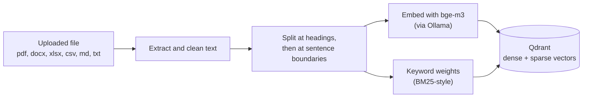
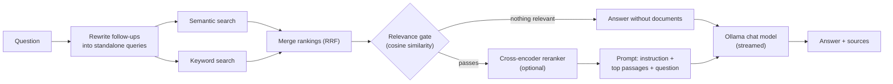

# Ollama RAG Chat

Chat with your own documents, entirely on your own machine. Upload PDFs, Word, Excel, CSV, Markdown or text files, ask questions in plain language, and get answers grounded in those files, with the exact passages each answer came from shown underneath. Language models run locally through [Ollama](https://ollama.com), so your documents never leave your computer.

<!-- Add screenshots to a docs/ folder, then uncomment:


-->

**Contents:** [Features](#features) · [Quick start](#quick-start) · [How it works](#how-it-works) · [Using the app](#using-the-app) · [Configuration](#configuration) · [API](#api) · [Design notes](#design-notes) · [Known limitations](#known-limitations) · [Troubleshooting](#troubleshooting) · [Project structure](#project-structure) · [Roadmap](#roadmap)

## Features

**Answers you can verify**
- Every answer lists the passages it was built from, with similarity score, keyword rank and (if enabled) reranker score. Expand a source to read the exact text.
- Choose which documents are searched with a checkbox per file.
- When nothing in your documents is relevant (for example "thanks!"), retrieval is skipped and the model simply replies.

**Retrieval pipeline**
- **Structure-aware chunking:** documents are split at headings first; only long sections are split further, at paragraph and sentence boundaries, with overlap. Continuation chunks carry their section heading.
- **Hybrid search:** meaning (dense embeddings with `bge-m3`) and exact terms (BM25-style keyword vectors) are searched together and merged with reciprocal-rank fusion.
- **Optional cross-encoder reranker** that re-reads the candidate passages against your question.
- **Follow-up handling:** a question like "and what about the second one?" is rewritten into a standalone search query using the recent conversation.

**Chat experience**
- Multiple chats in a sidebar: searchable, renamable, persisted in the browser. Every delete asks for confirmation.
- Streaming answers with a Stop button, edit-and-resend, regenerate and copy.
- Markdown with tables, syntax-highlighted code with a Copy button, and LaTeX math. Model output is sanitised with DOMPurify before display.
- Per-message timestamp, response time and model name. Dark and light themes.

**Documents**
- Upload several files at once (`.pdf` `.docx` `.xlsx` `.csv` `.md` `.txt`). Re-uploading a file replaces the old version. The Documents tab shows chunk count, size and upload date.

**Tunable**
- Edit the answering instruction, and adjust retrieval thresholds, Top-K, keyword search, reranking and conversation memory from the Settings tab.

## Quick start

### Prerequisites

- [Docker Desktop](https://www.docker.com/products/docker-desktop/) (Compose v2)
- [Ollama](https://ollama.com) running on the host machine, with an embedding model and at least one chat model:

```bash
ollama pull bge-m3        # required: used to embed documents and questions
ollama pull llama3.2      # or any chat model you prefer
```

### Run

```bash
git clone https://github.com/<your-username>/ollama-rag-chat.git
cd ollama-rag-chat
docker compose up --build -d
```

Open **http://localhost:8080**. The first build takes a few minutes.

| Service  | URL                    | Notes                                          |
|----------|------------------------|------------------------------------------------|
| Frontend | http://localhost:8080  | The app                                        |
| Backend  | http://localhost:8000  | FastAPI; interactive docs at `/docs`           |
| Qdrant   | http://localhost:6333/dashboard | Vector database (localhost only)      |

Useful commands:

```bash
docker compose logs -f backend    # watch the backend
docker compose down               # stop (documents and model cache are kept)
docker compose down -v            # stop AND delete all documents and the model cache
```

**Platform notes.** Developed and tested on macOS (Apple Silicon) with Docker Desktop. Ollama stays outside Docker on purpose: containers on macOS cannot use the GPU. On Linux, Ollama must listen on an address the container can reach (`OLLAMA_HOST=0.0.0.0`); Linux and Windows are untested.

### Running without Docker for the app code (development)

```bash
docker compose up -d qdrant                 # the database still runs in Docker

cd backend
python3 -m venv venv && source venv/bin/activate
pip install -r requirements.txt
cd app && python3 main.py                   # http://localhost:8000 (auto-reloads)

cd ../../frontend                           # in a second terminal
npm install
npm run dev                                 # http://localhost:5173
```

## How it works

**Indexing (on upload)**



**Answering (on each question)**



| Layer     | Technology |
|-----------|------------|
| Frontend  | Vue 3, Vite, `marked`, highlight.js, KaTeX, DOMPurify |
| Backend   | FastAPI, httpx, document parsers (`pypdf`, `python-docx`, `openpyxl`) |
| Models    | Ollama: `bge-m3` for embeddings, any chat model for answers |
| Vector DB | Qdrant: one dense and one sparse vector per chunk |
| Reranker  | `fastembed` cross-encoder (ONNX, runs inside the backend) |
| Packaging | Docker Compose |

## Using the app

1. **Documents tab:** upload one or more files. Tick or untick files to control what is searched.
2. **Chat tab:** ask a question. The line under the chat shows which documents are in use. Open **Sources** under an answer to read the retrieved passages. If a follow-up was rewritten, the rewritten query is shown.
3. **Settings tab:** turn the knowledge base on or off, edit the instruction the model receives, and open **Advanced retrieval**:

| Setting | Default | What it does |
|---|---|---|
| Keyword search (hybrid) | on | Also match exact words, not only meaning |
| Reranker | off | Re-read candidates against the question; the first use downloads a model |
| Minimum rerank score | off | Drop passages the reranker scores below this (the scale depends on the model) |
| Passages sent to the model (Top-K) | 3 | How many passages go into the prompt |
| Close-match threshold | 0.45 | Cosine similarity at which a passage is always used |
| Keyword-match floor | 0.30 | A keyword hit also needs at least this similarity |
| Keyword-rank limit | 5 | A keyword hit must rank in the top N keyword results |
| Conversation memory | 5 exchanges | Previous question/answer pairs the model sees |

## Configuration

Environment variables for the backend (set in `docker-compose.yml`):

| Variable | Default | Purpose |
|---|---|---|
| `OLLAMA_BASE_URL` | `http://localhost:11434` | Where Ollama is reachable (Compose uses `host.docker.internal`) |
| `QDRANT_HOST` / `QDRANT_PORT` | `localhost` / `6333` | Qdrant location (Compose uses the `qdrant` service) |
| `EMBEDDING_MODEL` | `bge-m3` | Ollama embedding model. Changing it requires re-uploading documents, and the vector size in `vector_store.py` must match |
| `EMBED_BATCH_SIZE` | `16` | Chunks per embedding request |
| `RERANK_MODEL` | set in `rerank.py` | Compose uses `BAAI/bge-reranker-v2-m3` (multilingual, about 2.3 GB). `BAAI/bge-reranker-base` is a lighter alternative |
| `FASTEMBED_CACHE_PATH` | system temp dir | Where reranker models are stored (Compose mounts a volume at `/models`) |

## API

| Method | Path | Purpose |
|---|---|---|
| GET | `/api/health` | Liveness check |
| GET | `/api/models` | Chat models installed in Ollama |
| POST | `/api/chat` | Streamed answer (see below) |
| POST | `/api/documents/upload` | Multipart upload of one file; replaces a file with the same name |
| GET | `/api/documents` | Documents with chunk count, size and upload date |
| DELETE | `/api/documents/{filename}` | Remove a document and all its chunks |
| POST | `/api/rerank/warmup` | Load (and on first use, download) the reranker |

**`POST /api/chat`** takes `model`, `messages`, `prompt_instruction`, `use_knowledge_base`, `document_filter` (`null` = all documents, `[]` = no retrieval, or a list of filenames) and `retrieval_settings`. The response is `text/plain`, streamed. The **first line** is `__META__` followed by JSON (`sources`, `search_query`, `rerank_status`); everything after that line is the answer text.

## Design notes

**Chunking matters more than it looks.** My first version cut documents every 800 characters. On a 24-page user manual, the question "How do I install the scheduler?" ranked the real installation commands third (cosine 0.61), cut off mid-command, behind a chunk of generic interface descriptions (0.67). Splitting at the manual's numbered headings fixed it: `2. Prerequisites` (0.68) and `3. Installation` (0.65) came back intact at ranks 1 and 2, and the table of contents ranked last. Cleaning the table of contents' dot leaders also removed about 16% of the extracted text, which had been polluting embeddings. This is one document and one question, an anecdote rather than a benchmark.

**The relevance gate uses cosine similarity, not fused scores.** Reciprocal-rank-fusion scores are rank-based and on a different scale than cosine, so a threshold on them would be meaningless. I merge the two result lists in code, keep each passage's real cosine score, and gate on that. This is also why "thanks!" retrieves nothing.

**Keyword vectors use a stable hash.** Python's built-in `hash()` is randomised per process, which would give the same word a different index after every restart. Tokens are hashed with CRC32 instead. Qdrant applies IDF weighting server-side, so it tracks the corpus as documents come and go.

**Failed re-uploads don't destroy data.** A replaced document is deleted only after the new version has been embedded successfully.

**Blocking work stays off the event loop.** Embedding, searching and reranking run in worker threads (or in plain `def` routes), so a large upload doesn't freeze chat.

**Stale data silently skews retrieval.** Early on, leftover chunks from an older chunking experiment kept showing up in results. That is why documents are keyed by filename, replaced on re-upload, and removable.

## Known limitations

- **No authentication.** Anyone who can reach port 8000 can upload and delete documents. Qdrant is bound to localhost, but the backend and frontend are not.
- **One shared knowledge base.** There are no users or per-user isolation.
- **Chats live in your browser's `localStorage`:** per browser and per origin (`localhost:5173` and `localhost:8080` are separate), capped at roughly 5 MB, and not shared between devices. The sidebar warns when saving fails.
- **The frontend calls `http://localhost:8000`** (set in `App.vue`), so it works from the same machine only unless you change it.
- **No OCR.** Scanned PDFs (pictures of text) produce no text and are rejected. PDF tables are flattened into lines of text.
- **Heading detection** covers numbered headings (`3. Installation`) and Markdown `#` headings only. Other documents fall back to paragraph and sentence splitting.
- **Keyword search has no stemming** ("installing" does not match "install"; the semantic side covers that), and the stop-word list is English. Chinese, Japanese and Korean text is tokenised into character pairs.
- **Thresholds were tuned by hand on a few documents,** not against a labelled test set. Treat the defaults as starting points.
- **Answer quality is bounded by the chat model.** Small local models can ignore the "only use the context" instruction.
- **The reranker is large** (about 2.3 GB by default), needs several GB of RAM, and adds latency per question.
- Documents are identified by filename: two different files with the same name replace each other.

## Troubleshooting

| Symptom | Fix |
|---|---|
| Model dropdown is empty | The backend can't reach Ollama. Check `ollama list`. In Docker, test with `docker compose exec backend python -c "import urllib.request; print(urllib.request.urlopen('http://host.docker.internal:11434/api/tags').status)"` |
| Upload fails with an embedding error | Run `ollama pull bge-m3` |
| `error getting credentials … docker-credential-desktop` | Remove the `"credsStore"` line from `~/.docker/config.json` |
| `Cannot connect to the Docker daemon` | Start Docker Desktop |
| `port is already allocated` (8000 or 8080) | Stop any local `python3 main.py` or `npm run dev` |
| Backend exits with code 137 | Out of memory. Raise Docker Desktop's memory limit or use a lighter `RERANK_MODEL` |
| Reranker takes forever the first time | It is downloading about 2.3 GB, once. Watch `docker compose logs -f backend` |
| Answers ignore my documents | Check the status line under the chat, lower the close-match threshold, and look at Sources to see what was retrieved |
| My chats disappeared | You opened the app on a different address; browser storage is per origin |

## Project structure

```
ollama-rag-chat/
├── docker-compose.yml
├── backend/
│   ├── Dockerfile
│   ├── requirements.txt
│   └── app/
│       ├── main.py                 # routes, RAG pipeline, streaming
│       ├── document_processing.py  # text extraction per file type, cleanup
│       ├── chunking.py             # structure-aware chunking
│       ├── embeddings.py           # batched embeddings via Ollama
│       ├── sparse.py               # keyword (BM25-style) vectors
│       ├── vector_store.py         # Qdrant storage and hybrid search
│       └── rerank.py               # optional cross-encoder reranker
└── frontend/
    ├── Dockerfile
    └── src/
        ├── App.vue                 # the whole UI
        ├── markdown.js             # markdown, highlighting, math, sanitising
        └── assets/theme.css        # light and dark theme variables
```

## Roadmap

- Store chats in Postgres (cross-device, no browser size limit)
- A small labelled evaluation set to measure retrieval changes instead of eyeballing them
- OCR for scanned PDFs
- Authentication and per-user knowledge bases
- Upload progress for very large files

## Acknowledgements

Built on [Ollama](https://ollama.com), [Qdrant](https://qdrant.tech), [FastEmbed](https://github.com/qdrant/fastembed), and the `bge-m3` and `bge-reranker` models from BAAI.